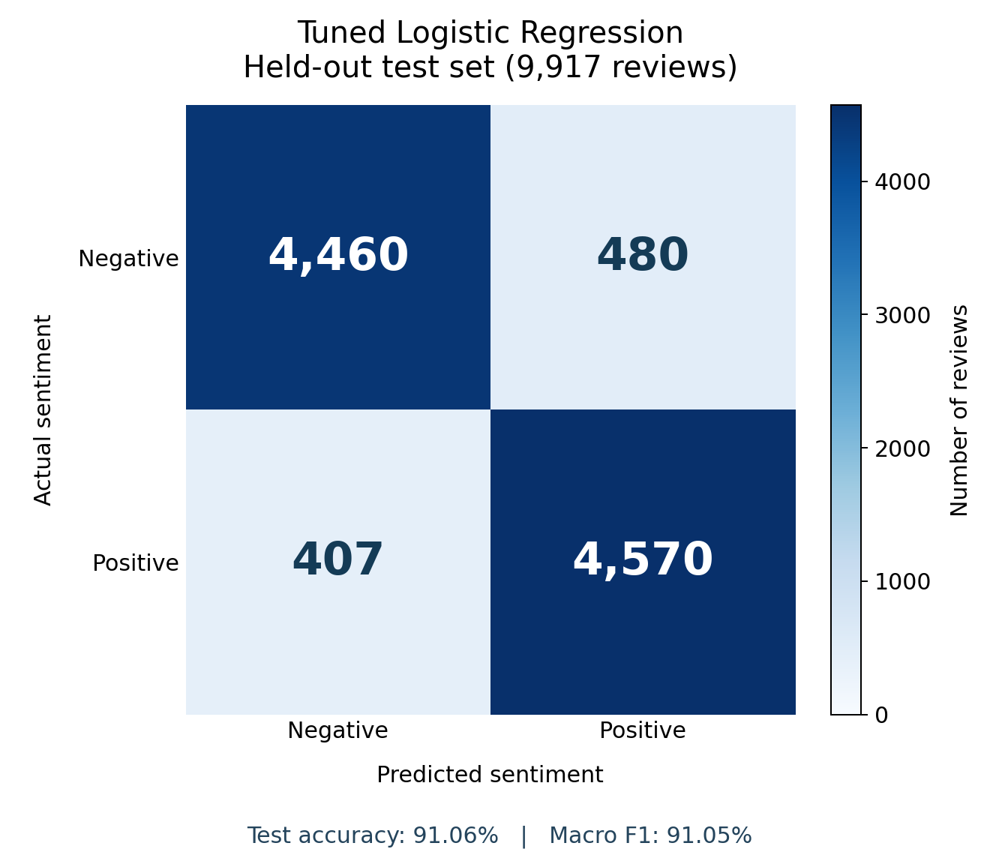

# Project Title: MLFlowPro — Movie Sentiment & Experiment Dashboard

MLFlowPro helps engineers train, compare, version, and use movie-review
sentiment models. It combines TF-IDF with Multinomial Naive Bayes and Logistic
Regression, tracks real experiment results in Django, and demonstrates
training-only Bayesian hyperparameter optimization. The published tuned model
achieved **91.06% held-out test accuracy** and **91.05% test macro F1**.

## 👥 Team Members & Contributions

All three team members are required to contribute code through their own GitHub
accounts. The responsibilities below describe their actual work:

- **Elige Diallo ([Elitelige7](https://github.com/Elitelige7))** — Training and evaluating Naive Bayes and Logistic Regression with TF-IDF.
- **Elijah Sow ([elsow1](https://github.com/elsow1))** — Django backend development, database models and migrations, REST APIs, admin setup, and initial API tests.
- **Kasaan Dornelus ([KHD-wq](https://github.com/KHD-wq))** — Original frontend dashboard development using HTML, JavaScript, and CSS.

---

## 🚀 Live Demo

**Live Demo:** [Open MLFlowPro](https://hardyboys-ml-project.onrender.com/)

The application must remain functional and accessible during the presentation.
Public predictions and results are available without signing in. GitHub team
sign-in restricts authenticated access to approved accounts. AI suggestions and
shared notes also use a private team access code.

### 🎥 Project Walkthrough


The walkthrough demonstrates the core review-prediction and metrics flow.
The current dashboard also includes saved-model selection, D3 charts, GitHub
sign-in, AI suggestion controls, and shared experiment notes. Test those
features directly in the live demo.

---

## 🛠️ Installation & Setup

### Prerequisites

- Python 3.11 and pip
- Git
- Windows PowerShell for the commands below

### Local Installation

Run commands from the repository root, which contains the `backend` folder.

```powershell
git clone https://github.com/Elitelige7/hardyboys-ml-project.git
cd hardyboys-ml-project
git switch feature/django-review-prediction

python -m venv .venv
.\.venv\Scripts\Activate.ps1
python -m pip install -r backend/requirements.txt
```

Create `backend/.env` in an editor:

```dotenv
DJANGO_SECRET_KEY=replace_with_a_generated_secret
DJANGO_DEBUG=True
```

Generate a secret with `python -c "import secrets; print(secrets.token_urlsafe(50))"`.
Keep the environment file out of Git. With no `DATABASE_URL`, local development
uses SQLite; a configured PostgreSQL URL selects the hosted database.

Initialize the database, import the original models, and restore any selected
published model bundles:

```powershell
python backend/manage.py migrate
python backend/manage.py loaddata backend/demo_results.json
python register_model_versions.py
python publish_model.py restore
python backend/manage.py runserver
```

Open [the local dashboard](http://127.0.0.1:8000/) and leave the server running.
The included fitted models support inference without downloading the dataset.
Model registration and bundle restoration preserve existing matching versions.

### Optional Feature Configuration

Configure these variables in `backend/.env` locally and in Render's environment
settings for the deployed service:

| Variable | Purpose |
|---|---|
| `GITHUB_CLIENT_ID`, `GITHUB_CLIENT_SECRET` | Credentials from the registered GitHub OAuth app |
| `GITHUB_ALLOWED_USERS` | Comma-separated approved GitHub usernames; the default is `Elitelige7,elsow1,KHD-wq` |
| `MLFLOWPRO_AI_ACCESS_CODE` | Private team code for shared notes and AI suggestion requests |
| `OPENAI_API_KEY` | Server-side provider key for AI suggestions |
| `OPENAI_MODEL` | Optional provider model identifier; the integration supplies a default |

GitHub's registered callback URLs must include both the live HTTPS callback
and `http://127.0.0.1:8000/accounts/github/login/callback/`. See the
[project handbook](docs/README.md) for exact configuration and troubleshooting.
The team access code is separate from the OpenAI API key.

---

## 📊 Dataset

- **Source:** [IMDb Dataset of 50K Movie Reviews](https://www.kaggle.com/datasets/lakshmi25npathi/imdb-dataset-of-50k-movie-reviews).
- **Input:** Review text in the `review` column.
- **Target:** `positive` or `negative` in the `sentiment` column.
- **Size:** 50,000 reviews before cleaning. The recorded tuned run retained
  **49,582** reviews after dropping missing rows and duplicate review texts.
- **Split:** **39,665 training reviews** and **9,917 test reviews**, using an
  80/20 stratified split with `random_state=42`.
- **Data pipeline:** Download and extract the CSV to `data/IMDB Dataset.csv`
  when retraining. The dataset is excluded from Git.

---

## 🧠 Model Architecture & Training

Each scikit-learn `Pipeline` contains a `TfidfVectorizer` and a classifier.
TF-IDF uses up to 50,000 features from individual words and adjacent word pairs.
The vectorizer is fitted only on training data.

| Algorithm | Role | Main setting |
|---|---|---|
| Multinomial Naive Bayes | Fast text-classification baseline | Smoothing parameter `alpha` |
| Logistic Regression | Weighted text-feature classifier | Regularization parameter `C`; `max_iter=1000` |

This is **binary sentiment classification**, not prediction of a movie's IMDb
rating. The models do not have a separate neutral class.

### Tracked Training

```powershell
python train_and_track_tuning.py --model both
```

The tracked trainer stores an experiment, settings, measured results, and a
UUID-named fitted pipeline. Provenance includes dataset and artifact hashes,
split information, and package versions. It preserves the original model files.

### Bayesian Hyperparameter Optimization

```powershell
python train_and_track_tuning.py --model logistic_regression --optimize --trials 6
```

Optuna TPE searches `C` using **three-fold stratified cross-validation on the
training portion only**, optimizing mean macro F1. TF-IDF remains inside each
fold's pipeline. After selection, the model is fitted on all training reviews
and evaluated on the held-out test set. Naive Bayes can be tuned with the same
command using `--model naive_bayes` to search `alpha`.

Naive Bayes is a classifier; Bayesian optimization is the separate parameter
search process. The tuned Logistic Regression model remains Logistic Regression.

### Local Celery Worker

In a separate activated terminal, run `python background_jobs.py worker`.
Then submit a job from another terminal:

```powershell
python background_jobs.py enqueue --model logistic_regression --trials 6
python background_jobs.py status YOUR_JOB_ID
```

Replace `YOUR_JOB_ID` with the returned UUID. The local worker uses a filesystem
broker and SQLite task results under `local_jobs/`. It is a local demonstration,
not a hosted distributed training worker.

---

## 📈 Evaluation & Results

### Held-out Test Comparison

| Model | Test Accuracy | Test Macro F1 |
|---|---:|---:|
| Multinomial Naive Bayes — recorded baseline | 88.34% | 88.34% |
| Logistic Regression — recorded baseline | 90.53% | 90.53% |
| Logistic Regression — six-trial TPE tuning | **91.06%** | **91.05%** |

The baseline rows are previously recorded evaluation results imported into the
dashboard. The tuned row comes from the measured October 19 training run and
its published model-version metadata.

### Tuned Run: Training vs. Test

| Metric | Training Set | Test Set |
|---|---:|---:|
| Accuracy | 98.86% | 91.06% |
| Macro F1 | 98.86% | 91.05% |

The selected `C` was **8.102356207766633**; training-only CV macro F1 was
**0.907489478465694**. The saved version ID is
`1b1e98fc-5fca-4d0c-98c8-52e459f772ce`. Numeric experiment IDs can differ
between local and deployed databases.



See [the recorded evaluation data](assets/evaluation/recorded_results.json)
for full-precision scores, the confusion matrix, trial history, and provenance.
The matrix uses actual labels as rows and predicted labels as columns, ordered
negative then positive. Its 9,917 entries match the held-out test-set size.

Accuracy measures the proportion of correct predictions. Macro F1 averages
the positive-class and negative-class F1 scores equally. The confidence shown
for a single review is a model-estimated probability, not the test accuracy.

The tuned model's train/test gap suggests overfitting. The observed baseline-to-
tuned test accuracy difference is about **0.53 percentage points**; no external
dataset evaluation or statistical significance analysis was performed. Baseline
training-set scores were not recorded. No percentage reductions in deployment
time or gains in reproducibility were measured.

---

## 🧰 Application Features & Technology

| Area | Implementation |
|---|---|
| Web framework and APIs | Python, Django, Django REST Framework |
| Frontend | HTML/CSS, jQuery/AJAX, browser Fetch, and D3.js |
| Database | Django ORM with local SQLite and hosted PostgreSQL configuration |
| Experiment tracking | Settings, metrics, provenance, and fitted model snapshots |
| Model versioning | Saved versions selectable during inference; selected bundles restored on deployment |
| Hyperparameter search | Optuna TPE with training-only cross-validation |
| Background execution | Demonstrated local Celery worker with a filesystem broker |
| Collaboration | Database-backed shared notes, WebSockets, revision conflicts, Channels, and Daphne |
| Authentication | GitHub OAuth2 with django-allauth and an approved-user list |
| AI suggestions | OpenAI integration returning reviewable settings and draft code |
| Verification | Django/Pytest tests and GitHub Actions configuration |
| Packaging and documentation | Docker configuration and a Sphinx handbook |
| Live hosting | Render web service |

### API Overview

| Endpoint | Purpose |
|---|---|
| `POST /api/predict/` | Predict review sentiment using the default or selected version |
| `GET /api/model-versions/` | Read saved model-version metadata |
| `GET /api/experiment-results/` | Read logged comparison metrics |
| `/api/experiments/`, `/api/model-settings/` | Authenticated experiment and settings operations |
| `POST /api/ai-suggestions/` | Request an LLM draft using the private team code |
| `/ws/experiment-notes/` | Authenticate and exchange shared-note updates over WebSocket |

See [the handbook's API reference](docs/source/api.rst) for validation,
authentication, and error responses.

---

<!-- MLFlowPro: Sphinx handbook -->
## ✅ Testing & Documentation

```powershell
python -m pip install -r requirements-dev.txt
python backend/manage.py check
python backend/manage.py makemigrations --check --dry-run
python -m pytest -q
```

Tests cover experiment APIs, default and versioned predictions, invalid inputs,
publication and restoration, AI request validation, WebSocket collaboration and
conflicts, OAuth state and callbacks, team restrictions, CSRF, and logout.
External provider calls are mocked in automated tests; real provider access
must be checked separately.

The [project handbook](docs/README.md) explains setup, architecture, training,
evaluation, APIs, deployment, and limitations. Build it locally:

```powershell
python -m pip install -r requirements-docs.txt
python -m sphinx -n -W --keep-going -b html docs/source docs/build/html
Start-Process .\docs\build\html\index.html
```

GitHub Actions contains backend and documentation checks. Confirm their actual
run results after pushing. The Docker setup includes an initialization script
and HTTP smoke checks; a successful configuration review alone does not prove
the container workflow has passed.

---

## ☁️ Deployment & Current Limitations

Render uses `python run_asgi.py` to serve Django and the notes WebSocket through
Daphne. Build initialization applies migrations and restores selected model
bundles from `published_models/`. The server uses a PostgreSQL `DATABASE_URL`
in the deployed environment.

- **LLM access:** Suggestion code is implemented, but provider credit/quota
  blocked real generation during setup. Funding and a successful provider
  request are still required for a verified live suggestion demo. Shared notes
  do not require OpenAI credit.
- **Collaboration scale:** Notes broadcast through one server process using an
  in-memory channel layer. Multiple processes or instances require a shared
  channel layer such as Redis.
- **Training deployment:** Celery tuning runs locally. A hosted worker, shared
  broker, and distributed artifact store have not been deployed.
- **Cloud orchestration:** The running web demo is on Render; no Kubernetes
  cluster is deployed.
- **Model scope:** Predictions are positive/negative only. Sarcasm, mixed
  sentiment, short inputs, and unfamiliar text can produce errors. Probabilities
  have not been separately calibrated.

---

## 🧑‍💻 Git Workflow & Guidelines

1. Create a feature branch for new work and commit regularly with descriptive
   messages.
2. Fetch and integrate the latest shared changes before pushing; resolve
   conflicts deliberately.
3. Push the feature branch and use a pull request for review before merging.
4. Each member commits their own work through their own GitHub account.
5. Confirm the instructor has repository collaborator access and the submission
   branch contains the final code, documentation, assets, and working demo link.

Do not publish `.env`, credentials, the training dataset, runtime databases,
local job files, or generated documentation builds. Selected published model
bundles are intentionally versioned with their measured metadata.
