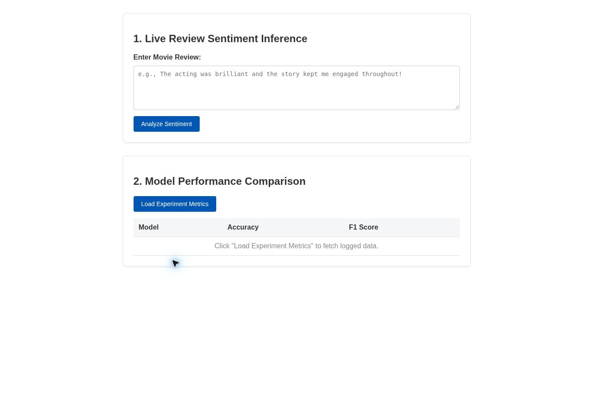

# HardyBoys-ml-project
Machine learning project by the HardyBoys team:

Elijah Sow,
Elige Diallo,
Kasaan Dornelus


MLFlow Pro: Movie Reviewer


## Model Evaluation

The project evaluates two machine-learning models for movie-review sentiment
classification: Multinomial Naive Bayes and Logistic Regression. Both models use TF-IDF vectorization to convert text reviews into numerical features. The dataset was divided into 80% training data and 20% testing data. The split used stratified sampling and a random seed of 42.

### Evaluation Results

| Model | Accuracy | Macro F1 Score |
|---|---:|---:|
| Multinomial Naive Bayes | 88.28% | 88.28% |
| Logistic Regression | 90.49% | 90.49% |

### Findings

Logistic Regression achieved the best results with an accuracy and a macro F1 score of 90.49%, while Naive Bayes achieved an accuracy and macro F1 score of 88.28%. These results indicate that Logistic Regression performed better on the test dataset, the prediction script currently uses the Logistic Regression model to classify individual movie reviews. Both models were also tested with six manually selected reviews that they both
produced identical predictions for all six examples. Correctly classifying
the clearly positive and negative reviews, but they both classified two
neutral reviews as negative. Since the models are trained for binary
positive vs negative classification, they do not have a separate neutral
sentiment category. The six manual tests provide a qualitative check, while the accuracy and
macro F1 scores provide quantitative evaluation on the test dataset.


## 🚀 Live Demo
[Open MLFlowPro](https://hardyboys-ml-project.onrender.com/)

### 🎥 Project Walkthrough


## 🛠️ Installation & Setup

### Prerequisites
- Python 3.11
- Git
- pip

### Local Installation

```powershell
git clone https://github.com/Elitelige7/hardyboys-ml-project.git
cd hardyboys-ml-project
python -m venv .venv
.\.venv\Scripts\Activate.ps1
python -m pip install -r backend/requirements.txt
```

Create `backend/.env` with:

```text
DJANGO_SECRET_KEY=your-generated-secret-key
DJANGO_DEBUG=True
```

Generate a secret key with:

```powershell
python -c "import secrets; print(secrets.token_urlsafe(50))"
```

Initialize the local database, import the recorded results, and start Django:

```powershell
python backend/manage.py migrate
python backend/manage.py loaddata backend/demo_results.json
python backend/manage.py runserver
```

Open http://127.0.0.1:8000/.

The local app uses SQLite. The deployed app uses PostgreSQL through the
`DATABASE_URL` environment variable. Keep `.env` out of version control.

## 📊 Dataset

- **Download:** https://www.kaggle.com/datasets/lakshmi25npathi/imdb-dataset-of-50k-movie-reviews
- **Description:** 50,000 labeled movie reviews for binary sentiment classification.
- **Input:** Review text in the `review` column.
- **Target:** `positive` or `negative` in the `sentiment` column.
- **Preparation:** Remove missing values and duplicate review texts.
- **Access:** Extract the CSV to `data/IMDB Dataset.csv` to retrain the models.

The dashboard uses the included saved models, so the dataset download is needed
for retraining.

## 🧠 Model Architecture & Training

Both models use scikit-learn pipelines:

1. TF-IDF converts review text into numeric features.
2. A classifier predicts positive or negative sentiment.

### Models
- Multinomial Naive Bayes
- Logistic Regression

### Training Configuration
- Stratified 80% training / 20% test split
- Random seed: 42
- TF-IDF maximum features: 50,000
- TF-IDF uses individual words and pairs of adjacent words
- Logistic Regression maximum iterations: 1,000

Run training from the repository root:

```powershell
python train_models.py
```

Training saves both complete pipelines in `models/`. The live prediction
endpoint uses the saved Logistic Regression pipeline.

## 📈 Evaluation & Results

Recorded results on the held-out test split:

| Model | Test Accuracy | Test Macro F1 |
|---|---:|---:|
| Multinomial Naive Bayes | 88.34% | 88.34% |
| Logistic Regression | 90.53% | 90.53% |

Training-set metrics were not recorded.

Accuracy measures the proportion of correct predictions. Macro F1 averages
the F1 scores of the positive and negative classes.

The dashboard loads these recorded evaluation results from the database.
The confidence shown for an individual review is the model's estimated
probability for its predicted class.

## ✅ Testing

Run the existing Django API tests:

```powershell
python backend/manage.py test experiments
```

Tests cover experiment creation and retrieval, model settings, result storage,
and authentication.

The public dashboard was also checked with positive and negative reviews,
and both models' recorded metrics were successfully loaded.

## 🔎 Current Scope & Limitations

The implemented app provides sentiment predictions and a comparison of saved
experiment results. Short reviews, sarcasm, and mixed opinions can produce
incorrect predictions.

LLM code suggestions, automated hyperparameter tuning, real-time collaboration,
OAuth2, and Kubernetes deployment are outside the current implementation.

## 🧑‍💻 Git Workflow & Guidelines

1. Develop changes on a feature branch.
2. Commit regularly with descriptive messages.
3. Push the branch and open a pull request.
4. Review changes before merging into `main`.
5. Each team member commits their own contributions.